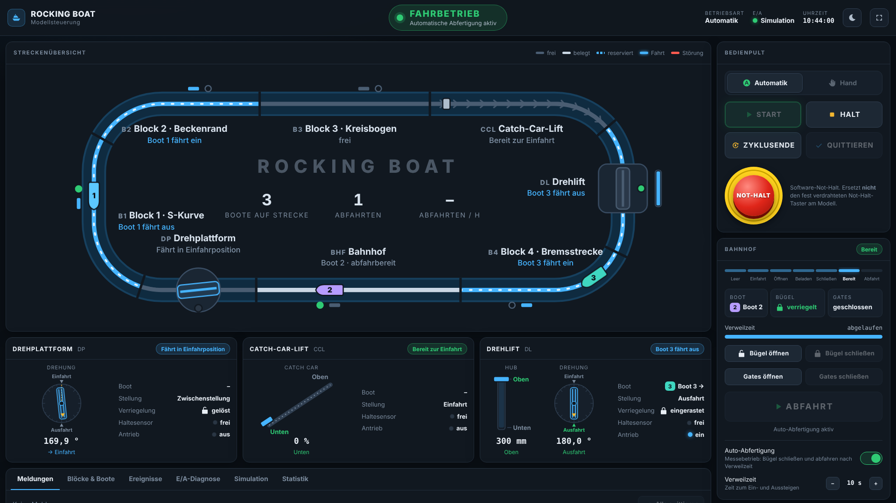

# Rocking Boat – Modellsteuerung

Steuerungsoberfläche für das Rocking-Boat-Messemodell mit **Drehplattform**, **Drehlift**, **Catch-Car-Lift**
und **Blockstrecke**. Die Oberfläche läuft im Browser (Bedienpanel, Tablet, Laptop). Ablaufsteuerung, Blocklogik und
eine vollständige Anlagensimulation laufen in einem kleinen Node.js-Server ohne externe Abhängigkeiten.



## Schnellstart

Voraussetzung: [Node.js](https://nodejs.org) ab Version 20. Es gibt nichts zu installieren.

```bash
npm start
```

Danach <http://localhost:8080> öffnen. Ohne Modell startet die Steuerung im **Simulationsbetrieb**, alle Funktionen
lassen sich so sofort ausprobieren. Für den Betrieb am Messestand empfiehlt sich der Vollbildmodus (Symbol oben rechts).

| Umgebungsvariable | Standard | Bedeutung |
| --- | --- | --- |
| `PORT` | `8080` | Port der Oberfläche |
| `HOST` | `127.0.0.1` | `0.0.0.0` macht die Oberfläche im Netzwerk erreichbar (z. B. für ein Tablet) |
| `IO_DRIVER` | `simulation` | `tcp` = reale Modell-Hardware, siehe [E/A-Protokoll](docs/e-a-protokoll.md) |
| `IO_HOST`, `IO_PORT` | `127.0.0.1`, `7000` | Adresse der Modell-Hardware |
| `RIDE_CONFIG` | `config/rocking-boat.json` | Streckenlayout |

## Aufbau der Oberfläche

- **Statusanzeige** (oben): Anlagenzustand in Klartext (*Bereit, Fahrbetrieb, Halt eingeleitet, Zyklusende,
  Handbetrieb, Störung, Not-Halt*) und dazu der nächste Bedienschritt.
- **Meldezeile**: Die wichtigste anstehende Störung oder Warnung bleibt immer sichtbar.
- **Streckenübersicht**: Rundkurs mit allen Blöcken, Belegung, Reservierung und laufenden Fahrten (animiert).
  Gezeigt werden Haltesensoren, Bremsen, Drehstellung von Drehplattform und Drehlift, Hubhöhe, Position des Catch Car
  sowie die Boote mit Nummer und Fahrtrichtung. Ein Klick auf einen Abschnitt springt zu seinen Details.
- **Bedienpult**: Betriebsart, `START`, `HALT`, `ZYKLUSENDE`, `QUITTIEREN` und `NOT-HALT`. Die Taster leuchten wie
  Leuchtdrucktaster. Ein blinkender Taster ist der nächste sinnvolle Schritt. Gesperrte Taster nennen den Grund als Tooltip.
- **Bahnhof**: Ablauf (*Leer → Einfahrt → Öffnen → Beladen → Schließen → Bereit → Abfahrt*), Bügel, Gates,
  Verweilzeit und `ABFAHRT`. Die **Auto-Abfertigung** (Messebetrieb) schließt nach der Verweilzeit selbstständig und fährt ab.
- **Element-Karten** für Drehplattform, Catch-Car-Lift und Drehlift: Zeigerinstrumente je Achse, Stellung,
  Verriegelung, Haltesensor, Antrieb. Im Handbetrieb kommen Positionstaster, Tipptaster und „Boot weiterfahren“ dazu.
- **Register** unten:
  - *Meldungen*: Störungen und Warnungen mit Quittierstatus.
  - *Blöcke & Boote*: Belegung, Sensoren, Bremsen und Fahrzeugverfolgung.
  - *Ereignisse*: Protokoll der letzten Vorgänge.
  - *E/A-Diagnose*: alle Signale live, wichtig für die Inbetriebnahme.
  - *Simulation*: Geschwindigkeit, Störungen einspielen, simulierter Not-Halt-Taster.
  - *Statistik*: Abfahrten, Abfahrten/h, Betriebszeit.
- Helles und dunkles Design umschaltbar, bedienbar vom Smartphone bis zum Panel mit 1920 × 1080.

## Bedienung

### Fahrbetrieb

1. Steuerung starten. Die Fahrzeugverfolgung liest die Boote aus den Haltesensoren ein, Boot 1 steht im Bahnhof.
2. Anstehende Meldungen prüfen und `QUITTIEREN`.
3. `START` startet den Fahrbetrieb. Bewegliche Elemente fahren selbstständig in ihre Positionen: Leer warten sie in
   Einfahrposition, mit Boot fahren sie in die Ausfahrposition.
4. Im Bahnhof öffnen Bügel und Gates nach der Einfahrt automatisch. Ohne Auto-Abfertigung schließt der Bediener mit
   `Bügel schließen` / `Gates schließen` und fertigt mit `ABFAHRT` ab.

### Anhalten

- **HALT** (Betriebshalt): Es beginnen keine neuen Fahrten mehr, laufende Fahrten und Achsbewegungen werden beendet.
  Danach steht die Anlage.
- **ZYKLUSENDE**: Der Bahnhof fertigt nicht mehr ab, alle Boote fahren bis vor den Bahnhof auf. Damit endet der
  Messetag oder eine Vorführung.
- **NOT-HALT**: Alle Antriebe aus, Bremsen zu, Achsen stehen, und zwar sofort beim Drücken. Wiederanlauf nur über
  `QUITTIEREN` und `START`. Unterbrochene Fahrten werden danach fortgesetzt.

### Störungen

Störungen halten die Anlage sofort an und erscheinen in Meldezeile und Register *Meldungen*. Überwacht werden:

| Meldung | Ursache |
| --- | --- |
| Zeitüberschreitung Fahrt | Boot kommt nicht im nächsten Abschnitt an (klemmt, Antrieb defekt) |
| Boot nicht mehr erkannt | Haltesensor meldet ein eingetragenes Boot nicht mehr |
| Unerwartetes Fahrzeug | Sensor meldet ein Boot in einem freien Abschnitt |
| Positionierung | Achse erreicht ihre Zielposition nicht (z. B. Drehplattform blockiert) |
| Verriegelung | Verriegelungsbolzen rastet nicht ein oder löst nicht |
| Not-Halt-Kreis | Not-Halt-Taster am Modell gedrückt |
| E/A-Verbindung | keine Daten von der Modell-Hardware |
| Bügel/Gates ohne Rückmeldung (Warnung) | Rückmeldung fehlt, Abfahrt bleibt gesperrt |

Nach Beheben der Ursache `QUITTIEREN` und `START`.

### Handbetrieb

Die Betriebsart lässt sich nur bei stehender Anlage wechseln. Im Handbetrieb wird jedes Element einzeln verfahren:

- `→ Einfahrt` / `→ Ausfahrt` fahren die Achsstellung an. Entriegeln und Verriegeln laufen automatisch.
- **Tipptaster** bewegen die Achse, solange sie gedrückt sind (Totmannfunktion). Kommt 400 ms lang kein Befehl mehr,
  etwa weil die Verbindung abreißt, stoppt die Achse.
- `Boot weiterfahren` fährt ein Boot genau einen Abschnitt weiter.
- `HALT` stoppt im Handbetrieb sofort alle Bewegungen.

**Alle Verriegelungen der Blocklogik gelten auch im Handbetrieb.**

### Fahrzeugverfolgung

Unter *Blöcke & Boote* lässt sich die Verfolgung korrigieren, nachdem ein Boot von Hand umgesetzt wurde:
`Eintragen` (Sensor meldet ein Boot, Abschnitt ist aber leer eingetragen), `Austragen` (umgekehrt) oder
`Verfolgung neu einlesen` (alles aus den Haltesensoren neu aufbauen).

## Ablaufsteuerung

Die Strecke ist ein Ring aus Abschnitten, jeder Abschnitt nimmt höchstens ein Boot auf. Ein Boot fährt nur weiter, wenn
alle Bedingungen erfüllt sind:

- Der nächste Abschnitt ist frei: nicht belegt, nicht reserviert, Sensor frei.
- Ein bewegliches Element als Ziel steht in **Einfahrposition** und ist verriegelt.
- Ein bewegliches Element als Start steht in **Ausfahrposition** und ist verriegelt.
- Aus dem Bahnhof: alle Bügel verriegelt, Gates geschlossen.
- In den Bahnhof: Gates geschlossen.
- Achsen eines Elements bewegen sich nie, während ein Boot auf- oder abfährt.

Die Simulation prüft diese Regeln unabhängig von der Steuerung (Register *Simulation → Prüfung der Verriegelungen*).
Die automatischen Tests fahren damit unter anderem 15 Minuten Dauerbetrieb und alle Störungsarten durch.

## Streckenlayout anpassen

Das Layout steht in [`config/rocking-boat.json`](config/rocking-boat.json). Abschnitte werden in Fahrtrichtung
aufgezählt, nach dem letzten folgt wieder der erste.

| Feld | Bedeutung |
| --- | --- |
| `boats` | Anzahl der Boote (mindestens ein Abschnitt muss frei bleiben) |
| `sections[].type` | `station`, `block`, `turntable`, `rotatingLift`, `catchCarLift` |
| `sections[].travelTime` | Fahrzeit in s vom vorherigen Halt bis zum Halt in diesem Abschnitt (Basis der Zeitüberwachung) |
| `sections[].lock` | Element besitzt eine Verriegelung |
| `sections[].axes` | Achsen mit `positions` (benannte Positionen), `min`, `max`, `speed`, `unit`, `display` (`rotary`, `vertical`, `incline`) |
| `sections[].entry` / `exit` | Achsstellung für Ein- bzw. Ausfahrt, z. B. `{ "hub": "unten", "drehung": "einfahrt" }` |
| `station.dwellTime`, `station.autoDispatch` | Verweilzeit und Auto-Abfertigung beim Start |
| `timing.*` | Überwachungszeiten (Sensorentprellung, Zeitreserven, Totmann-Zeit) |
| `simulation.initialBoats` | Startpositionen der Boote in der Simulation |

> **Stand des Standardlayouts:** S-Kurve, Bogen an der Beckenwand, Kreisbogen und Drehplattform stammen aus dem
> Testvideo, siehe [Streckenrekonstruktion](docs/strecke-aus-video.md). Bahnhof, Catch-Car-Lift, Drehlift, Drehwinkel
> und Hubwege sind noch Annahmen (Bahnhof → Drehplattform 180° → S-Kurve → Beckenrand → Kreisbogen → Catch-Car-Lift →
> Drehlift 300 mm/180° → Bremsstrecke). Die Oberfläche baut sich vollständig aus der Konfiguration auf.

## Anbindung der Modell-Hardware

Die Steuerung spricht über ein einfaches zeilenweises JSON-Protokoll per TCP mit der Firmware des Modells, etwa einem
ESP32/Arduino mit Netzwerk oder einem SPS-Gateway. Seriell geht es über eine TCP-Brücke. Signalliste, Nachrichtenformat
und Pflichten der Firmware (Watchdog, Halt am Sensor) beschreibt [docs/e-a-protokoll.md](docs/e-a-protokoll.md).

```bash
npm run io-list               # Signalliste zum aktuellen Layout
npm run emulator              # Hardware-Emulator (Referenz für die Firmware)
IO_DRIVER=tcp npm start       # Steuerung mit TCP-Treiber
```

## Sicherheit

- Diese Software ist **keine Sicherheitssteuerung**. Der Not-Halt des Modells muss fest verdrahtet sein und die Antriebe
  hardwareseitig abschalten. Der Software-Not-Halt und `safety.estopOk` sind zusätzliche Funktionen. Für Fahrgeschäfte
  mit Personenbeförderung gelten EN 13814 und EN ISO 13849.
- Die Oberfläche hat keine Benutzeranmeldung. Sie lauscht standardmäßig nur auf `127.0.0.1`. Mit `HOST=0.0.0.0`
  nur in einem abgeschlossenen Netz betreiben, z. B. im eigenen WLAN des Messestands und nicht im Hallennetz.
- Befehle werden nur als JSON angenommen. Formulare fremder Webseiten können keine Befehle auslösen.

## Entwicklung

```bash
npm test                      # Steuerung, Simulation, HTTP-Server und TCP-Treiber
```

```
config/rocking-boat.json      Streckenlayout
src/controller/controller.js  Ablaufsteuerung: Blocklogik, Betriebsarten, Überwachung, Meldungen
src/controller/alarms.js      Meldeliste mit Quittierung
src/io/simulation.js          Anlagensimulation (gleiche Signale wie die Hardware)
src/io/tcp-json.js            TCP/JSON-Treiber für die Modell-Hardware
src/server.js                 HTTP-Server, Server-Sent Events, Steuerungszyklus (50 ms)
public/                       Bedienoberfläche (HTML/CSS/JavaScript ohne Build-Schritt)
tools/                        Hardware-Emulator, Signalliste
test/                         Tests (node:test)
```
