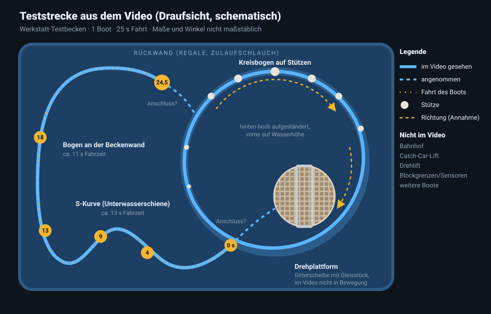

# Streckenrekonstruktion aus dem Testvideo

Quelle: Video `IMG_0518.MOV` (25 s, 1280 × 720). Ein Boot fährt in einem Testbecken in der Werkstatt.
Ausgewertet wurden zwei Einzelbilder pro Sekunde.

## Im Video gesehen

| Element | Beobachtung |
| --- | --- |
| Schiene | Unterwasserschiene aus zwei blauen Rohren mit weißen Haltern auf dem Beckenboden. Das Boot schwimmt und folgt ihr. |
| S-Kurve | Schlangenlinie mit zwei Gegenbögen. Das Boot braucht dafür rund **13 s** (0–13 s im Video). |
| Bogen an der Beckenwand | Langer Bogen entlang der Seitenwand bis zur Rückwand, rund **11 s** (13–24,5 s). |
| Kreisbogen auf Stützen | Großer Kreis auf weißen Stützen, hinten hoch aufgeständert, vorne auf Wasserhöhe. Im Video ohne Boot. |
| Drehplattform | Runde Gitterscheibe mit geradem Gleisstück, innerhalb des Kreisbogens. Dreht sich im Video nicht. |
| Boot | 1 Boot mit 12 Plätzen (6 Reihen à 2), fährt durchgehend mit dem Bug voraus und hält unterwegs nicht. |

## Nicht im Video

Bahnhof, Catch-Car-Lift, Drehlift, Blockgrenzen bzw. Haltesensoren und weitere Boote kommen nicht vor.
Offen bleibt auch, wie S-Kurve, Kreisbogen und Drehplattform miteinander verbunden sind und in welche
Richtung der Kreisbogen befahren wird.

## Übernahme in `config/rocking-boat.json`

| Abschnitt | Herkunft | Fahrzeit |
| --- | --- | --- |
| Bahnhof | Annahme | 4 s |
| Drehplattform (180°) | gesehen, Drehwinkel angenommen | 3 s |
| Block 1 · S-Kurve | gesehen | 13 s (gemessen) |
| Block 2 · Beckenrand | gesehen | 11 s (gemessen) |
| Block 3 · Kreisbogen | gesehen, Fahrtrichtung angenommen | 12 s (geschätzt) |
| Catch-Car-Lift | Annahme | 3 s |
| Drehlift (180°, senkt 300 mm ab) | Annahme | 3 s |
| Block 4 · Bremsstrecke | Annahme | 5 s |

Mit 3 Booten ergibt das in der Simulation rund 126 Abfahrten pro Stunde, etwa alle 27 s eine.

## Entscheidungen

Wo das Video nichts zeigt, ist das Layout so gewählt, dass es zum Gesehenen passt und physikalisch aufgeht.

1. **Bahnhof vor der Drehplattform, Drehung 180°.** Im Video fährt das Boot gleich neben der Drehplattform mit dem
   Bug voraus in die S-Kurve. Deshalb stehen die Boote im Bahnhof rückwärts (`display.stationHeading: 180`), die
   Drehplattform dreht sie nach vorn.
2. **Kreisbogen im Uhrzeigersinn als Auftauchstrecke.** Das Boot erreicht den Bogen hinten links, wo er tief liegt.
   Hinten steigt der Bogen auf den hohen Stützen aus dem Wasser und taucht vorne bei der Drehplattform wieder ein.
3. **Danach Catch-Car-Lift, dann Drehlift.** Der Catch Car zieht das Boot nach oben. Der Drehlift dreht es um 180° und
   **senkt es ab**, damit Bremsstrecke und Bahnhof wieder auf Wasserhöhe liegen. Das Boot fährt das Finale rückwärts
   und kommt so mit dem Heck voraus im Bahnhof an, passend zu Punkt 1.
4. **Blöcke:** S-Kurve, Beckenrand und Kreisbogen sind je ein Block mit Haltesensor am Ende. Im Video hält das Boot
   nicht. Die Steuerung hält es am Blockende nur kurz an (0,3 s), wenn der nächste Block frei ist.
5. **3 Boote.** Auch wenn alle drei gleichzeitig fahren und je einen Zielblock reservieren, bleiben von 8 Abschnitten
   2 frei. Die Anlage kann sich also nicht selbst blockieren.

Diese Werte lassen sich in `config/rocking-boat.json` ändern, sobald die tatsächlichen Maße bekannt sind.
